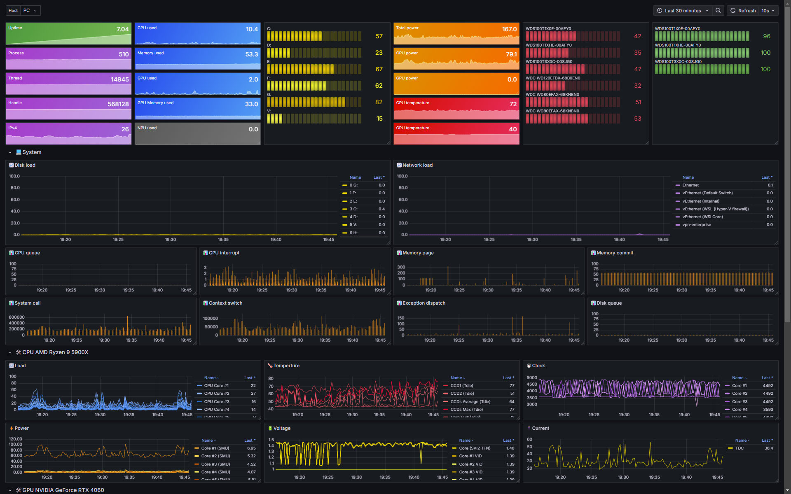
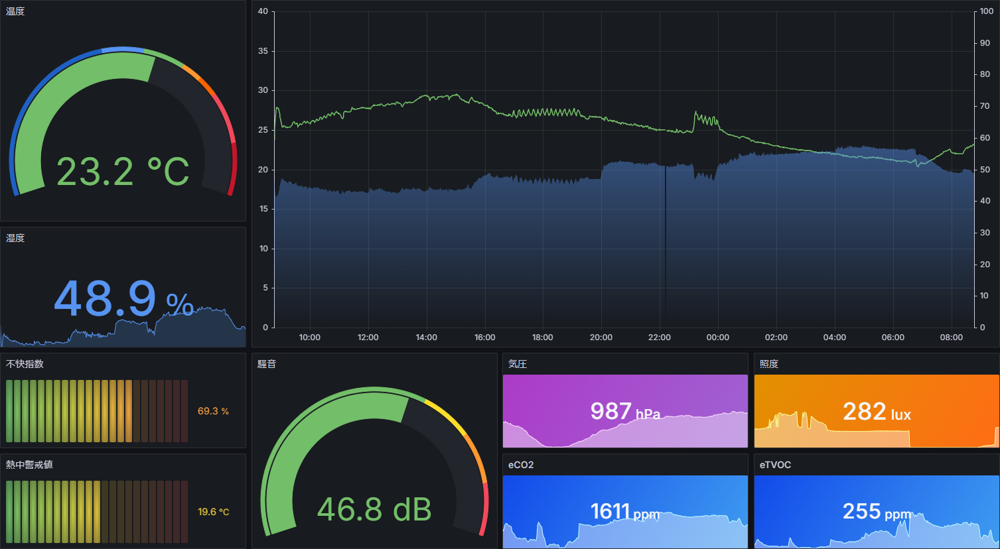
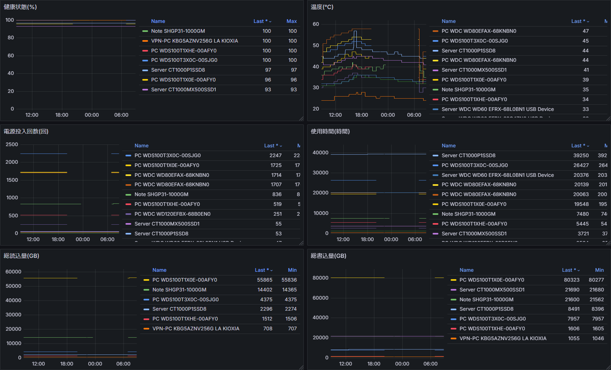
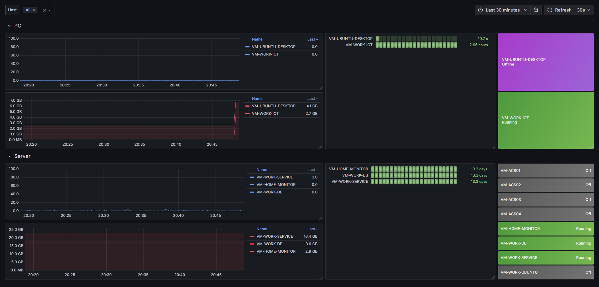
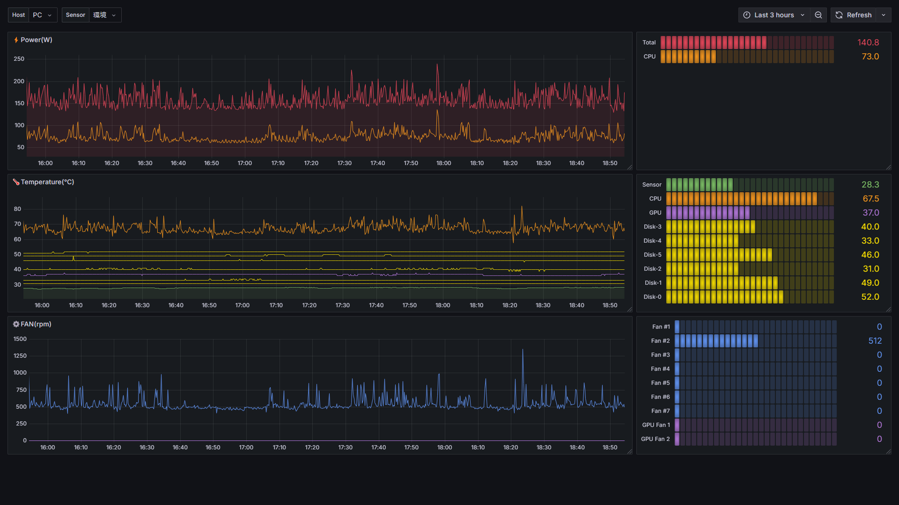
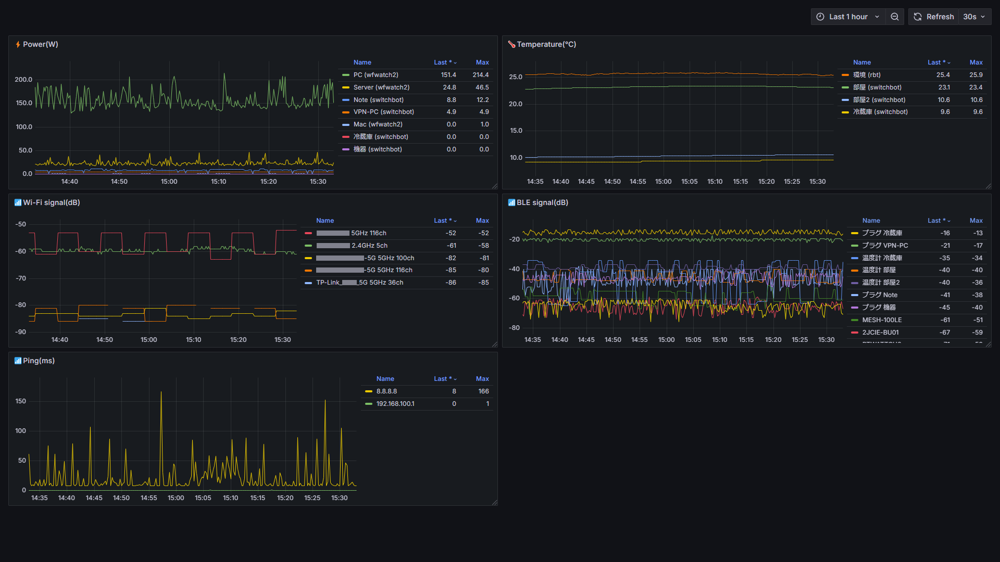
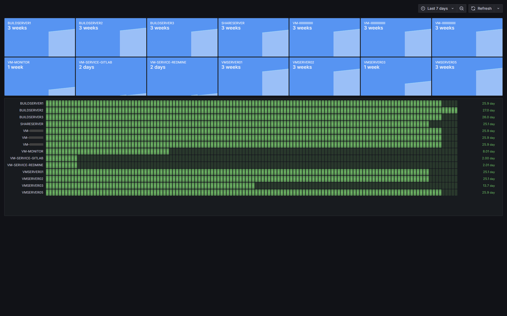
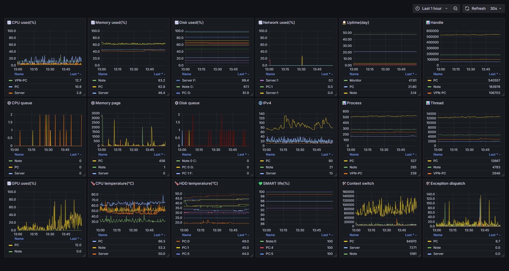

# prometheus-exporter-alternative

Prometheus Exporter alternative implementation by .NET



# Metrics

## RS-WFWATTCH2

Power, current and voltage of the Wi-Fi watt checker [RS-WFWATTCH2](https://www.ratocsystems.com/products/sensor/watt/rswfwattch2/).

* Instrumentation: `WFWattch2`
* Platform: Windows, Linux, Mac
* Library: [DeviceLib.WFWattch2](https://github.com/usausa/devicelib-wfwattch2)

```
sensor_power
sensor_current
sensor_voltage
```

## RS-BTWATTCH2

Power, current and voltage of the Bluetooth watt checker [RS-BTWATTCH2](https://www.ratocsystems.com/products/sensor/watt/rsbtwattch2/) from BLE advertisement packets.

* Instrumentation: `BTWattch2`
* Platform: Windows, Linux

```
sensor_rssi
sensor_power
sensor_current
sensor_voltage
```

## SwitchBot

Values of [SwitchBot Meter](https://www.switchbot.jp/products/switchbot-meter) and [SwitchBot Plug Mini](https://www.switchbot.jp/products/switchbot-plug-mini) from BLE advertisement packets.

* Instrumentation: `SwitchBot`
* Platform: Windows, Linux

for SwitchBot Meter

```
sensor_rssi
sensor_temperature
sensor_humidity
sensor_co2
```

for SwitchBot Plug Mini

```
sensor_power
```

## 2JCIE-BU

Environment values of the USB environment sensor [2JCIE-BU](https://www.fa.omron.co.jp/products/family/3724/lineup.html) via serial port.

* Instrumentation: `SensorOmron`
* Platform: Windows, Linux, Mac
* Library: [DeviceLib.SensorOmron](https://github.com/usausa/devicelib-sensor-omron)



```
sensor_temperature
sensor_humidity
sensor_light
sensor_pressure
sensor_noise
sensor_discomfort
sensor_heat
sensor_tvoc
sensor_co2
sensor_seismic
```

## Libre Hardware Monitor

Hardware sensors such as CPU, GPU, memory, storage, network, motherboard and battery.

* Instrumentation: `HardwareMonitor`
* Platform: Windows
* Library: [LibreHardwareMonitorLib](https://github.com/LibreHardwareMonitor/LibreHardwareMonitor)

```
hardware_battery_charge
hardware_battery_degradation
hardware_battery_voltage
hardware_battery_current
hardware_battery_capacity
hardware_battery_rate
hardware_battery_remaining
hardware_cpu_load
hardware_cpu_clock
hardware_cpu_temperature
hardware_cpu_voltage
hardware_cpu_current
hardware_cpu_power
hardware_gpu_load
hardware_gpu_clock
hardware_gpu_fan
hardware_gpu_temperature
hardware_gpu_power
hardware_gpu_memory
hardware_gpu_throughput
hardware_io_control
hardware_io_fan
hardware_io_temperature
hardware_io_voltage
hardware_memory_used
hardware_memory_available
hardware_memory_load
hardware_storage_used
hardware_storage_bytes
hardware_storage_speed
hardware_storage_temperature
hardware_storage_life
hardware_storage_spare
hardware_storage_amplification
hardware_network_bytes
hardware_network_speed
hardware_network_load
```

## S.M.A.R.T

S.M.A.R.T values of disks.

* Instrumentation: `DiskInfo`
* Platform: Windows, Linux, Mac
* Library: [HardwareInfo.Disk](https://github.com/usausa/hardwareinfo-disk) (Windows), [LinuxDotNet.Disk](https://github.com/usausa/linux-dotnet) (Linux), [MacDotNet.Disk](https://github.com/usausa/mac-dotnet) (Mac)



```
smart_disk_byte_per_sector
smart_nvme_value
smart_generic_value
```

## Performance Counter

Windows performance counters listed in `appsettings.json`.

* Instrumentation: `PerformanceCounter`
* Platform: Windows

```
performance_* (default)
```

## Hyper-V

State and resource usage of Hyper-V virtual machines.

* Instrumentation: `HyperV`
* Platform: Windows



```
hyperv_vm_count
hyperv_vm_information
hyperv_vm_state
hyperv_vm_processor_load
hyperv_vm_memory_usage
hyperv_vm_uptime
```

## NPU

Information and load of NPUs.

* Instrumentation: `Npu`
* Platform: Windows

```
hardware_npu_information
hardware_npu_load
hardware_npu_load_average
hardware_npu_context_count
hardware_npu_context_time
```

## Linux

System metrics of Linux such as CPU, memory, disk, network and battery.

* Instrumentation: `Linux`
* Platform: Linux
* Library: [LinuxDotNet.SystemInfo](https://github.com/usausa/linux-dotnet)

```
system_uptime
system_interrupt_total
system_context_switch_total
system_forks_total
system_scheduler_task
system_softirq_total
system_cpu_time_total
system_load_average
system_memory_mem gauge
system_memory_buffers gauge
system_memory_cached gauge
system_memory_swap_cached gauge
system_memory_lru gauge
system_memory_unevictable gauge
system_memory_mlocked gauge
system_memory_swap gauge
system_memory_dirty gauge
system_memory_writeback gauge
system_memory_anon_pages gauge
system_memory_mapped gauge
system_memory_shmem gauge
system_memory_k_reclaimable gauge
system_memory_slab gauge
system_memory_kernel_stack gauge
system_memory_page_tables gauge
system_memory_commit_limit gauge
system_memory_committed_as gauge
system_memory_hardware_corrupted gauge
system_virtual_page_total counter
system_virtual_swap_total counter
system_virtual_page_faults_total counter
system_virtual_steal_total counter
system_virtual_scan_total counter
system_virtual_oom_kill_total counter
system_partition_used
system_partition_total
system_partition_free
system_disk_completed_total
system_disk_merged_total
system_disk_sectors_total
system_disk_time_total
system_disk_ios_in_progress
system_disk_io_time_total
system_disk_weight_io_time_total
system_fd_allocated
system_fd_used
system_network_bytes_total
system_network_packets_total
system_network_errors_total
system_network_dropped_total
system_network_fifo_total
system_network_compressed_total
system_network_frame_total
system_network_multicast_total
system_network_collisions_total
system_network_carrier_total
system_tcp_statics
system_process_count
system_thread_count
hardware_cpu_frequency
hardware_cpu_power
hardware_battery_capacity
hardware_battery_voltage
hardware_battery_current
hardware_battery_charge
hardware_battery_charge_full
hardware_ac_online
hardware_monitor
```

## Raspberry Pi

Temperature, frequency, voltage, throttling and GPIO of Raspberry Pi.

* Instrumentation: `Raspberry`
* Platform: Linux (Raspberry Pi)
* Library: [RaspberryDotNet.SystemInfo](https://github.com/usausa/raspberrypi-dotnet)

```
hardware_vcio_temperature
hardware_vcio_frequency
hardware_vcio_voltage
hardware_vcio_throttled
hardware_gpio_level
```

## Mac

System metrics of macOS such as CPU, memory, disk, network and GPU.

* Instrumentation: `Mac`
* Platform: Mac
* Library: [MacDotNet.SystemInfo](https://github.com/usausa/mac-dotnet)

```
system_uptime
system_cpu_time_total
system_cpu_load
system_load_average
system_memory_mem
system_memory_load
system_memory_page_total
system_memory_swap_io_total
system_swap
system_partition_size_used
system_partition_size_total
system_partition_size_free
system_partition_size_available
system_partition_files_total
system_partition_files_free
system_disk_bytes_total
system_disk_completed_total
system_disk_time_total
system_disk_errors_total
system_fd_open_files
system_fd_open_vnodes
system_network_bytes_total
system_network_packets_total
system_network_errors_total
system_network_dropped_total
system_network_multicast_total
system_network_collisions_total
system_process_count
system_thread_count
hardware_cpu_frequency
hardware_gpu_utilization
hardware_gpu_memory
hardware_power_energy
hardware_monitor
hardware_monitor_fan_rpm
```

## Ping

Round trip time of ping to the configured targets.

* Instrumentation: `Ping`
* Platform: Windows, Linux, Mac

```
ping_result_time
```

## BLE signal strength

Signal strength of nearby BLE devices from advertisement packets.

* Instrumentation: `Ble`
* Platform: Windows, Linux

```
ble_rssi
```

## WiFi signal strength

Signal strength of nearby Wi-Fi access points.

* Instrumentation: `Wifi`
* Platform: Windows
* Library: [ManagedNativeWifi](https://github.com/emoacht/ManagedNativeWifi)

```
wifi_rssi
```

## Device battery

Battery level of wireless devices such as Logitech HID++ devices and Bluetooth devices.

* Instrumentation: `DeviceBattery`
* Platform: Windows
* Library: [DeviceLib.Battery](https://github.com/usausa/devicelib-battery)

```
device_battery_level
device_battery_charging
device_battery_voltage
device_battery_connected
```

# Gallery






# Install

## Windows

Copy files to install directory.

* PrometheusExporter.exe
* appsettings.json

```
sc create PrometheusExporter binPath=(install directory)\PrometheusExporter.exe start=auto
```

```
sc start PrometheusExporter
```

## Linux

Service file example.

```
[Unit]
Description=Prometheus Exporter

[Service]
WorkingDirectory=/opt/exporter
ExecStart=/opt/exporter/PrometheusExporter
Restart=always
RestartSec=5
KillSignal=SIGINT

[Install]
WantedBy = multi-user.target
```

## Prometheus

Add targets to prometheus.yml.

```yaml
  - job_name: 'alternative'
    scrape_interval: 10s
    static_configs:
      - targets: ['192.168.1.101:9228']
```
